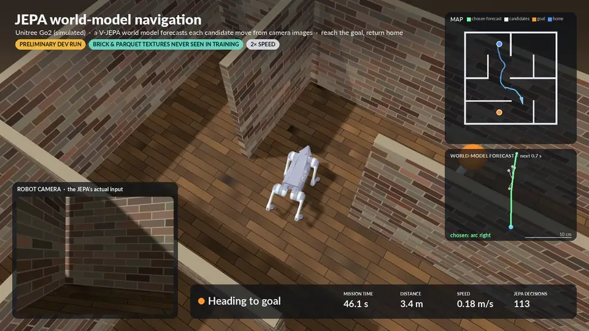

# Go2-JEPA-Navigation

**[Full navigation demo — 1080p, 30 fps, 52 seconds](assets/demo/jepa-navigation.mp4)** · Reach the goal, then return home.

When do JEPA world-model representations carry decision-relevant information for robot navigation, beyond kinematic
prediction, reactive control and explicit memory?

This repository is a simulated Unitree Go2 navigation testbed in [Genesis](https://github.com/Genesis-Embodied-AI/Genesis).
It compares five controller types on procedurally generated mazes: each must find a beacon from a goal image and return
home, from onboard RGB-D only.

| Controller | What forecasts the motion of each candidate action |
|---|---|
| **C0** | oracle (privileged geometry and pose) |
| **C1** | command history: a ridge model on past and prospective commands (no images) |
| **C2** | reactive: no motion forecast |
| **C3** | **JEPA**: a frozen V-JEPA 2.1 ViT-L encoder and a learned action-conditioned predictor; a decoder reads motion from the predicted future features |
| **C4** | supervised: the same frozen features, commands and candidate tape, mapped straight to motion |

All controllers share one harness, the reserve-exit-v2 navigation stack: RGB-D tracking, an occupancy map, route
planning, safety vetoes, and an optional recovery layer. Only the motion forecast differs.

> **Status:** the LeWMQuad-v3 development programme is consolidated here as a clean, reproducible artefact. Every
> port was gated against a frozen snapshot of the original code: rerun missions and experiments reproduce the original
> runs exactly, and every component retrains from scratch with its seed. See
> [docs/MIGRATION_STATUS.md](docs/MIGRATION_STATUS.md). All results so far are **preliminary** (development mode).

## What is here

| Path | Contents |
|---|---|
| `go2nav/mazes` | maze and scene generation, set registration with exclusion of earlier graphs |
| `go2nav/sim` | Genesis scene from a maze spec, cameras and sensor packets, depth noise, dynamics perturbations |
| `go2nav/locomotion` | the Go2 PPO locomotion policy: training (rsl-rl) and the command contract |
| `go2nav/perception` | RGB-D visual tracking, floor registration, occupancy mapping, obstacle evidence |
| `go2nav/planning` | candidate primitives, route planning, the reserve-exit harness, safety vetoes, recovery |
| `go2nav/models` | V-JEPA encoder wrapper, the horizon-conditioned predictor, readouts, the C3 decoder, C4, C1 |
| `go2nav/controllers` | C0–C4 and the development variants C1A (adaptive) and C1R (refit) |
| `go2nav/corpus` | the May bulk-rollout corpus behind T1: scene generation, resumable bulk rollouts with the data collectors, render plans, labels, the render |
| `go2nav/data` | data collection, verified deterministic replay, training samples, feature caches |
| `go2nav/training` | every learned component, retrainable from scratch with a seed and a lineage manifest |
| `go2nav/eval` | mission and cohort runners, episode evaluation, mission and demonstration videos |
| `configs/experiments` | one config per comparison, run by `python -m go2nav.eval.cohort`; the development variants (forecast degradation, clearance margins, look-around, adaptive and refit C1, marked strips) are mission options |
| `data` | registered maze sets, collection plans, the May corpus plan; training samples (hosted, see `artifacts`) |
| `assets` | CC0 surface textures (corpus render and demonstration videos) |
| `tests` | unit tests and equivalence tests against recorded originals |
| `artifacts` | manifest of checkpoints and data (URLs, SHA-256, licences) and a fetch script |
| `env` | the locked ROCm environment and the corpus render environment |
| `tools/porting` | the porting gates against the original programme (replay, mission, evaluation and cohort checks) |

## Reproducing

[docs/REPRODUCE.md](docs/REPRODUCE.md) gives every stage's command, from mazes and the locomotion policy to the
corpus, the learned chain (T1-T8, with seeds), the missions and the comparisons, and what each was checked against.

## Platform

AMD ROCm 7.2, torch 2.12, Genesis 0.4.6, Python 3.12. See [env/](env/). CPU physics is deterministic, and logged
missions replay bit-exactly.

## Licence

Apache License 2.0: [LICENSE](LICENSE) and [NOTICE](NOTICE). Third-party components (Genesis, the Go2 model, rsl-rl,
the V-JEPA 2.1 encoder, CC0 textures) are listed with their terms in [THIRD_PARTY_NOTICES.md](THIRD_PARTY_NOTICES.md).
